# PKM Nexus 使用说明书

扩展版本：0.7.3。本说明书由固定测试用例与本轮实际截图生成。

> 上次完整演示尚未完成全部验收：Windows 电脑操作工具未能可靠识别当前浏览器 URL，安全检查停止了本轮电脑操作。下文保留 0.5.2 演示的实际状态；新增功能有独立验证记录，未执行项目仍不算通过。

> 普通网页捕获保存标题、链接和你选择的文字；未选字时不会抓取整篇正文。网页快照保存当前可见区域的 PNG，不是完整网页归档，也不保存视频本体。

## 1. 从哪里开始

1. 在 chrome://extensions 重新加载扩展，保持原加载目录；关闭旧侧栏再重新打开。不要先卸载，以免丢失浏览器内部记录。
2. 点击工具栏企鹅图标打开侧栏，普通记录、网页快照、清单、网页组是四个直接入口。
3. 新记录先进入收件箱。点击整理页可搜索、添加标签、管理项目树与关系图、批量整理和备份。
4. 侧栏底部问号和整理页左下角使用说明书都能打开本文；图文随扩展保存，断网也能读。

收件箱内置六条示例，展示网页链接、文字、录音、多媒体笔记及真实 Wiki / CHETNA 快照。侧栏底部点击“查看 6 条内置示例”可直接到达；已有个人记录时也默认展开。录音标明虚拟麦克风。底部显示当前版本 0.7.3。

示例预览不计入个人记录数，也不参与同步。点击“保存到我的收件箱”加入单条，或点击示例区末尾“全部加入我的收件箱”整批加入。加入后成为可编辑的普通记录并使用当前同步设置；重复加入不会覆盖你的修改或恢复已删除记录。隐藏后可从底部示例入口或设置恢复。

下图来自交互回归的独立测试浏览器，展示侧栏底部的版本和示例入口。

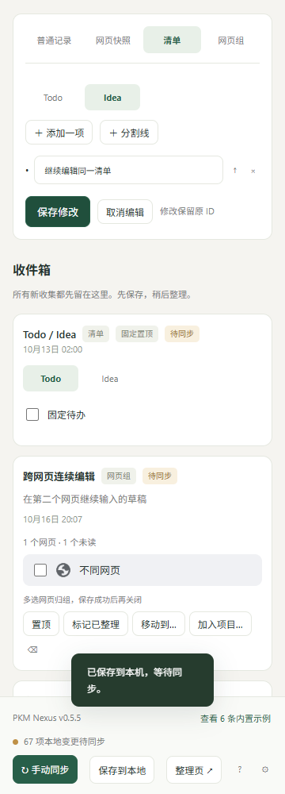

保存或清空后保留当前收集类型，清单继续原 ID 与 Todo / Idea 模式。网页组选择列表的“加入所选网页”固定在顶部。

多次右键收集文字、链接或图片，会在当前笔记的 `## collected:` 区域每次追加一个 bullet，保留正文与来源。图片可读取时复制为本机附件，受限时在 Markdown 中嵌入原图在线地址。导出 Markdown 会把笔记和本机图片一起打包为 ZIP；侧栏关闭期间也会排队保存。

标签是单层多选分类，拖动标签块到记录上追加。项目支持子项目与多项目归属；拖动记录到项目文件夹。点击记录先预览，再选择简单或完整修改。喜爱独立归类，关键词功能已停用。项目关系图支持全屏、拖动、预览、交互连线与子项目节点。

## 本地资料库与 Google Drive 同步

打开扩展设置，点击“下载 Windows 本地应用”，直接保存内置的 Companion 0.4.1 ZIP。先退出旧程序，将 ZIP 解压到固定目录，双击 PKM-Nexus.exe，保留 runtime 和 app 文件夹。小窗口正常运行不弹终端，关闭或最小化会收进右下角托盘，双击图标恢复。新版采用原厂签名运行时和可读源码，构建检查实际扫描结果及 SHA-256；旧 0.4.0 包继续停用。

在小窗口点击“设置与资料管理”，登记扩展设置页显示的扩展 ID，再回到扩展点击“连接并启用本地资料库”。连接后已保存内容自动交接；Chrome 后台每分钟重试，不要求侧栏保持打开。

点击“登录自己的 Google 账号”，在系统浏览器选择自己的账号并授权。每位用户各自使用自己的 Drive，PKM Nexus 的 OAuth 客户端只标识应用。新版已内置应用客户端配置，普通用户无需创建 Google Cloud 项目或导入 JSON；应用中显示的当前账号才是实际同步的 Drive 归属。

登录后，第一台创建自己拥有的 Drive 资料库，另一台使用同一账号选择相同资料库。界面显示当前账号，换号后停止原资料库的云端读写。立即同步或启用每小时任务后执行云同步。浏览器保存、本地资料库写入和 Drive 同步状态分别显示。

Drive 失败保留本地数据；冲突版本在本地管理程序处理。关闭 Chrome 后仍可同步已交接内容；尚留在浏览器的修改需等待 Chrome 再次运行。扩展设置不需要仓库或访问令牌。

## 主题、清单与项目图

点击记录先预览，再选择 Markdown 简单修改或完整修改。标签拖到记录上，记录拖到项目上；网页组内删除网页会划线保留，可恢复。鼠标进入整理页整个左侧导航栏，或进入插件侧栏任意位置时，企鹅平滑放大；离开后平滑恢复。侧栏四个收集入口保持一排。

清单直接输入 task1 并按 Enter：Todo 自动生成复选框，Idea 生成条目。输入 --- 并按 Enter 生成分隔线。底层保存 Markdown，点开 Markdown 源码可直接修改；尚未提交的一行也会保存为草稿。

整理页左下角、侧栏底部 ◐ 或设置中打开主题与字体。可选择纸张、明亮、深色或跟随系统，调整六种颜色，以及不同区域的字号和字体。即时预览，保存后应用到本机各扩展页面；取消恢复之前的设置。

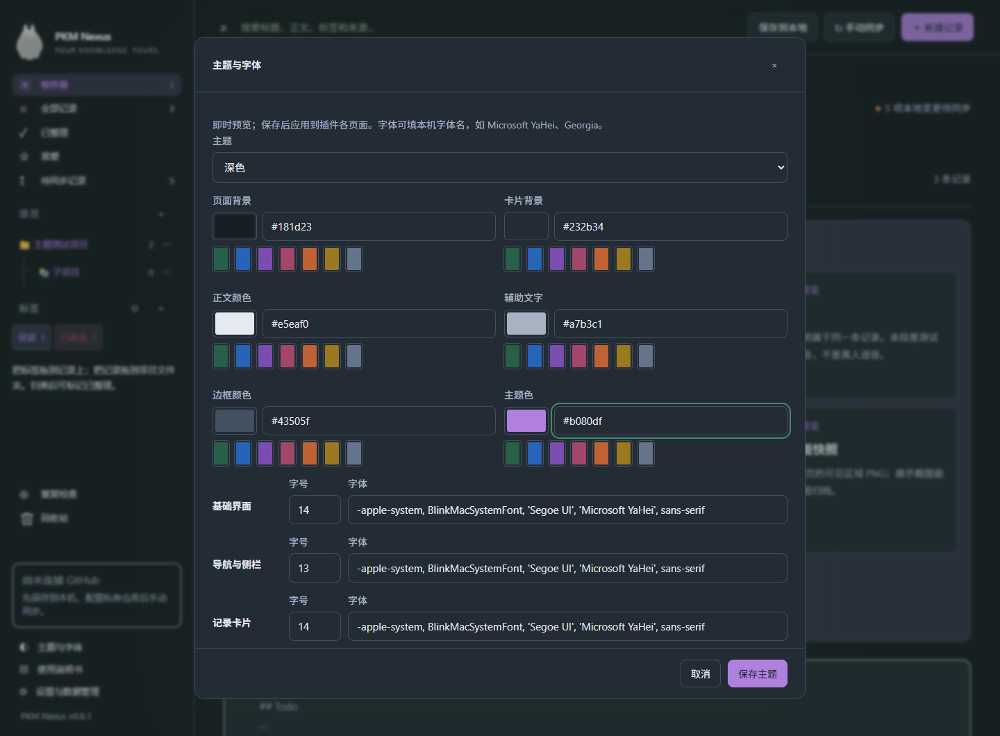

右键标签或点击标签区齿轮，直接点选标签，可修改名称和颜色；标签不带图标，并使用紧凑高度。颜色可用可见色块、预设或十六进制输入。项目提供基础图标选择，导航显示项目树连接线。普通导航图标为 20px，回收站为 22px，与文字居中对齐。

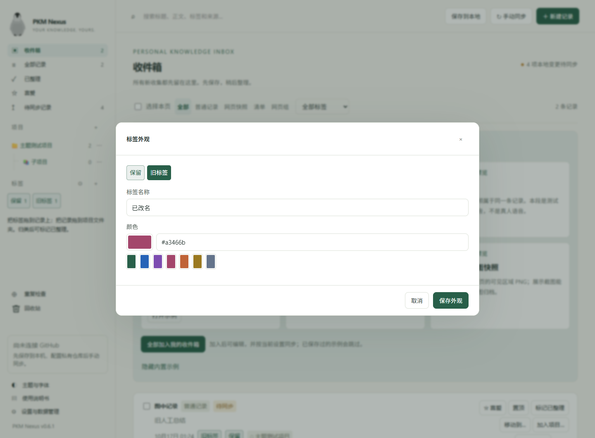

项目图支持全屏、拖动、指针位置的滚轮缩放、预览和交互连线。记录节点直接编辑人工总结，子项目节点直接编辑描述，输入后自动保存；右侧预览点编辑记录可进入完整编辑器。保存、取消、关闭或按 Escape 后都返回原关系图，保留当前项目层级、缩放、全屏、选中卡片和未提交的关系说明，并更新预览。编辑子项目同样返回原图。子项目是一个节点，项目描述显示在标题下。

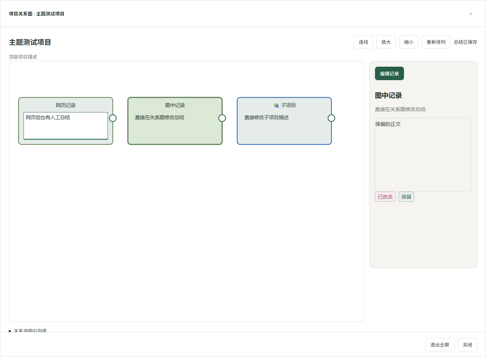

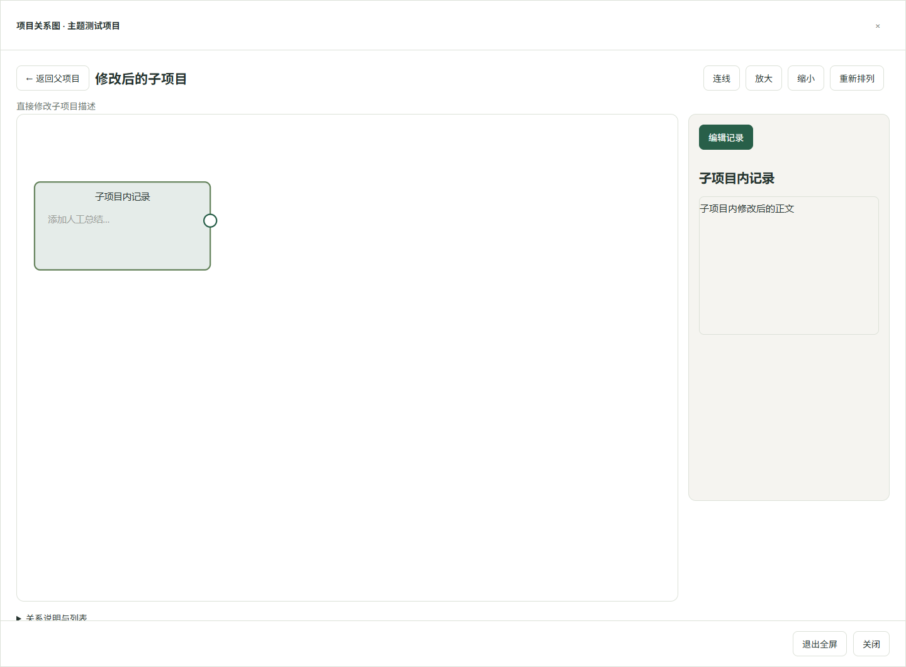

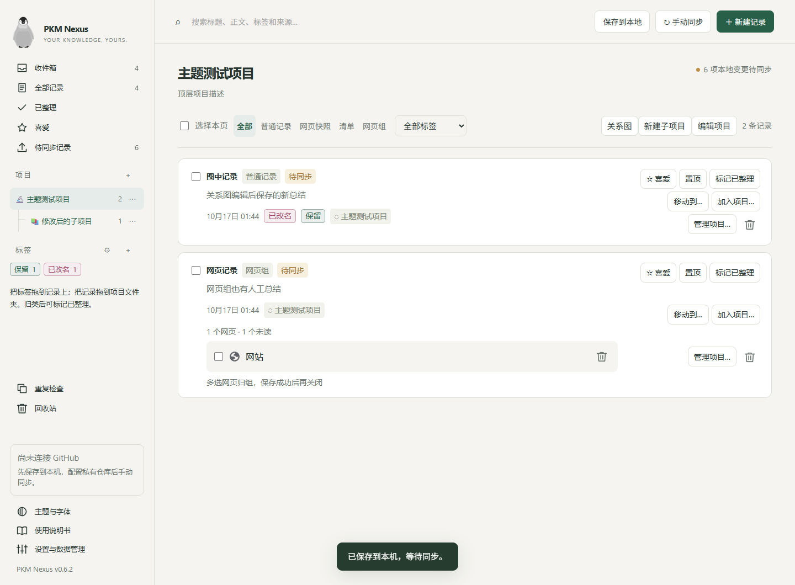

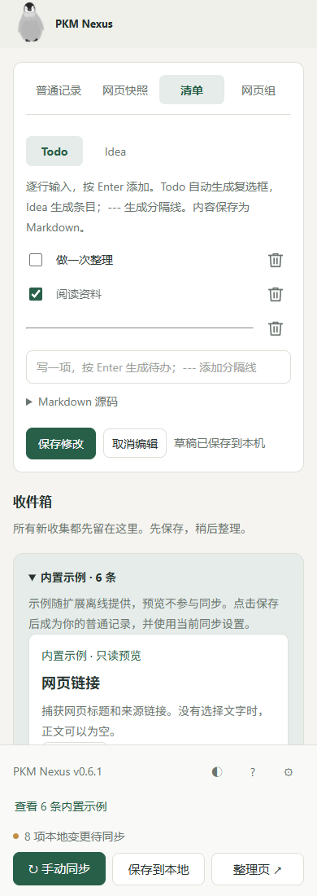

## 2. 权限与数据保存

捕获提示需要授权时，点击允许访问此网站并重试，在 Chrome 确认。跨网站使用可在设置与数据管理 → 网页访问权限主动允许所有网站。截图需要所有网站权限，或先回到网页点击工具栏扩展图标，取得当前页临时权限后重试。不要在 Chrome 内部页面上截图。

网页组手动加入或拖入 Bilibili 等链接时，不需要先授权读取网页。已有标签页或拖拽文字会用作标题；未授权且没有标题时显示网站域名，原链接仍可保存。需要更具体的标题可手动填写。下图是无 Bilibili 网站授权时添加两条链接的实际结果，测试确认未发网页请求、未产生 CORS 错误。

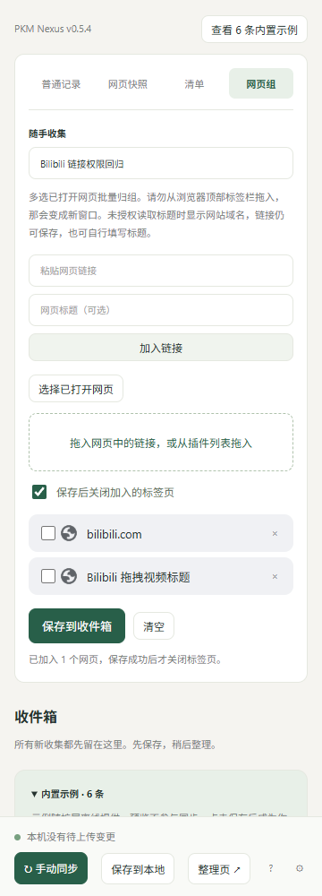

点击开始录音时申请麦克风，停止后生成音频附件。添加图片支持按钮选择文件及正文粘贴。保存记录前媒体只附在当前草稿；保存后原文件单独存储，Markdown 保留相对路径。

浏览器本地保存、浏览器交接到配套程序、配套程序上传 Google Drive 是三个不同状态。保存到本地会下载完整 ZIP，不能用它代替上传同步。

## 3. 本轮验证范围

固定回归：2026-10-15T15:53:45.870Z，156.0.8078.4，通过 9 / 失败 1 / 阻塞 0

真实网站：2026-10-15T15:52:21.283Z，通过 4 / 失败 0 / 阻塞 1

> 自动化录音使用虚拟麦克风；离线样例页面有显著标识；同步使用 MockDrive 与测试传输桥，不访问 Google、不更改 Native Messaging 注册、不创建 Windows 任务。真实 Google OAuth 与每小时同步需要用户完成后续验收。

截图按操作后的实际界面生成。点击内置说明书中的截图可打开原图；失败或阻塞会保留实际状态，不改写成成功。

## 普通记录

### N01 · 直接捕获当前网页

1. 打开 Wiki 页面，点击普通记录的捕获当前网页。
2. 确认标题和来源；不选择文字时正文可以为空，保存到收件箱。

验收条件：保存一条普通记录，标题与来源 URL 正确；没有选中文字时不自动抓取全文。

本轮固定样例结果：**通过**。

操作 1：打开wiki页面并确认可见内容

预期：页面主体可见，未将错误页当作业务页面

实际：页面主体可见，未将错误页当作业务页面（通过）

操作 2：点击捕获当前网页，进入可编辑草稿

预期：来源为 Wiki；未选字时正文为空

实际：来源为 Wiki；未选字时正文为空（通过）

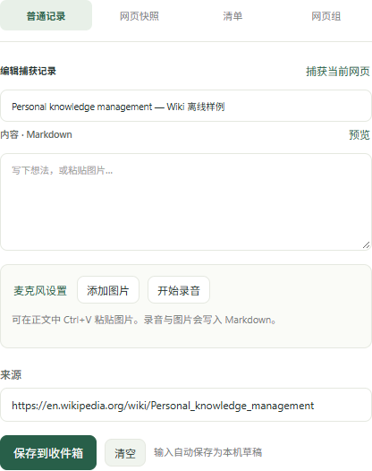

操作 3：保存到收件箱并核对持久化结果

预期：保存一条记录；ID、类型与来源/附件正确

实际：note；来源 1；附件 0（通过）

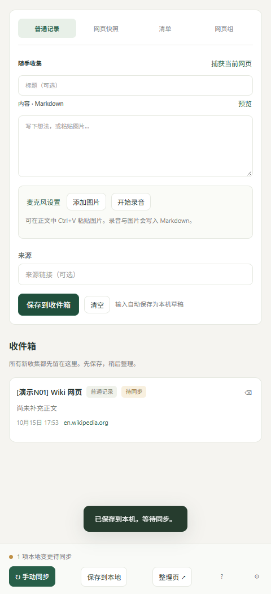

本轮真实网站结果：**通过**。

操作 1：打开wiki页面并确认可见内容

预期：页面主体可见，未将错误页当作业务页面

实际：页面主体可见，未将错误页当作业务页面（通过）

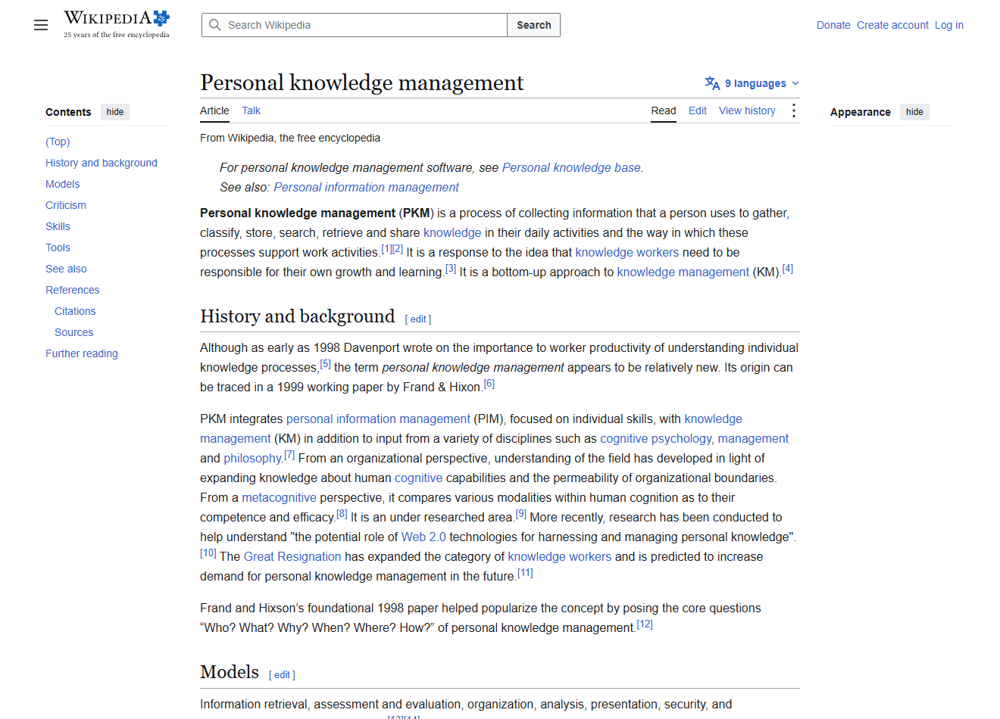

操作 2：点击捕获当前网页，进入可编辑草稿

预期：来源为 Wiki；未选字时正文为空

实际：来源为 Wiki；未选字时正文为空（通过）

操作 3：保存到收件箱并核对持久化结果

预期：保存一条记录；ID、类型与来源/附件正确

实际：note；来源 1；附件 0（通过）

### N02 · 直接添加文字

1. 输入标题：[演示N02] 本周学习计划；正文：先收集，再整理。周五回顾本周资料。
2. 保存后重新打开并核对文字。

验收条件：文字保存完整；重新打开不丢失，记录 ID 不变。

本轮固定样例结果：**通过**。

操作 1：输入普通文字笔记

预期：正文和标题可编辑，草稿留在本机

实际：正文和标题可编辑，草稿留在本机（通过）

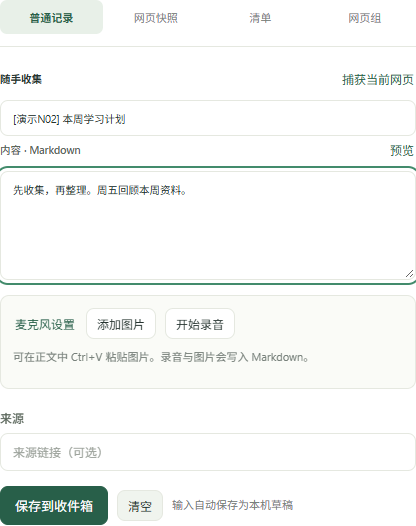

操作 2：保存到收件箱并核对持久化结果

预期：保存一条记录；ID、类型与来源/附件正确

实际：note；来源 0；附件 0（通过）

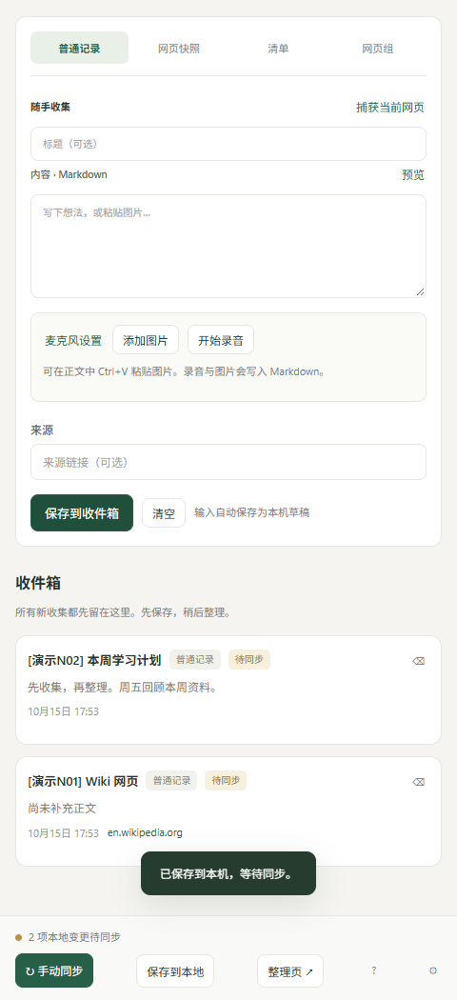

操作 3：重新打开已保存笔记

预期：正文逐字一致，编辑原记录

实际：正文逐字一致，编辑原记录（通过）

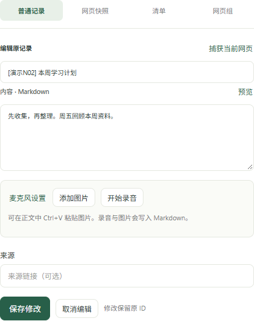

### N03 · 文字加音频

1. 输入标题：[演示N03] 口述灵感；正文：用声音补充文字。点击开始录音。
2. 录制至少两秒，停止并试听；保存后重新打开。

验收条件：存在非空、可播放的音频附件；正文、附件和记录 ID 保留。自动化使用虚拟麦克风，真人麦克风另验。

本轮固定样例结果：**通过**。

操作 1：开始录音，等待至少两个持久化音频片段

预期：界面处于录音状态；虚拟麦克风产生真实 MediaRecorder 数据

实际：界面处于录音状态；虚拟麦克风产生真实 MediaRecorder 数据（通过）

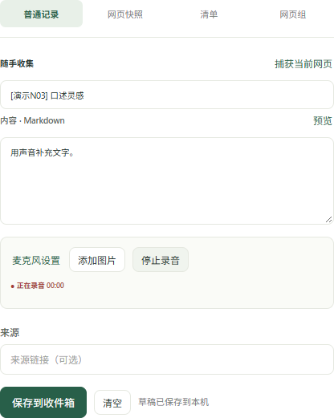

操作 2：停止录音并实际播放

预期：音频播放器时间前进，文字和音频属于同一条草稿

实际：音频播放器时间前进，文字和音频属于同一条草稿（通过）

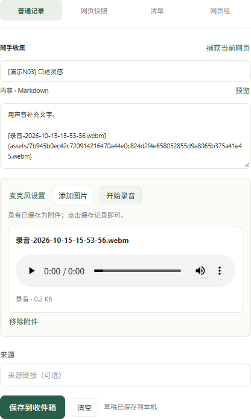

操作 3：保存到收件箱并核对持久化结果

预期：保存一条记录；ID、类型与来源/附件正确

实际：note；来源 0；附件 1（通过）

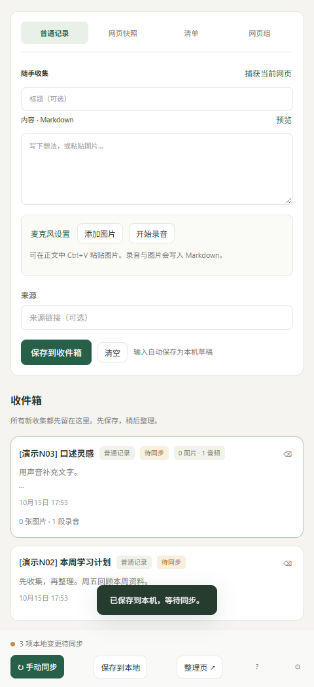

### N04 · 网页加文字、音频和图片

1. 捕获 CHETNA 页面，补充文字：记录城市排放地图的阅读思路。
2. 添加项目企鹅 PNG、录制音频，预览全部媒体后保存。

验收条件：同一条记录同时包含网页来源、文字、图片和可播放音频；没有拆成多条记录。

本轮固定样例结果：**通过**。

操作 1：打开chetna页面并确认可见内容

预期：页面主体可见，未将错误页当作业务页面

实际：页面主体可见，未将错误页当作业务页面（通过）

操作 2：开始录音，等待至少两个持久化音频片段

预期：界面处于录音状态；虚拟麦克风产生真实 MediaRecorder 数据

实际：界面处于录音状态；虚拟麦克风产生真实 MediaRecorder 数据（通过）

操作 3：预览网页来源、文字、图片和音频

预期：一条草稿同时具有四类内容

实际：一条草稿同时具有四类内容（通过）

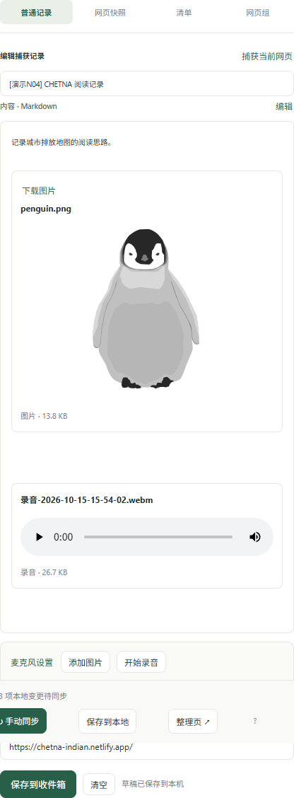

操作 4：保存到收件箱并核对持久化结果

预期：保存一条记录；ID、类型与来源/附件正确

实际：note；来源 1；附件 2（通过）

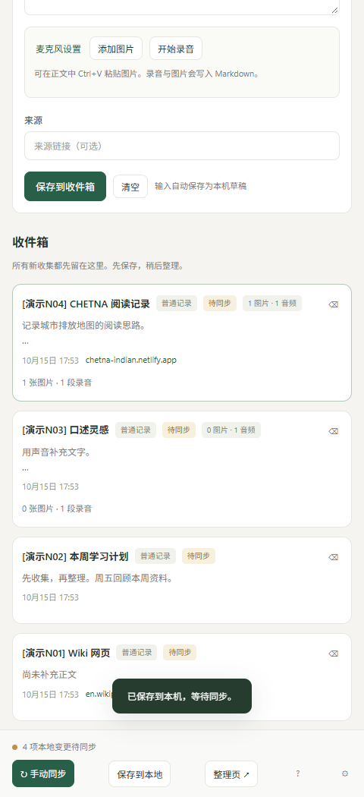

本轮真实网站结果：**通过**。

操作 1：打开chetna页面并确认可见内容

预期：页面主体可见，未将错误页当作业务页面

实际：页面主体可见，未将错误页当作业务页面（通过）

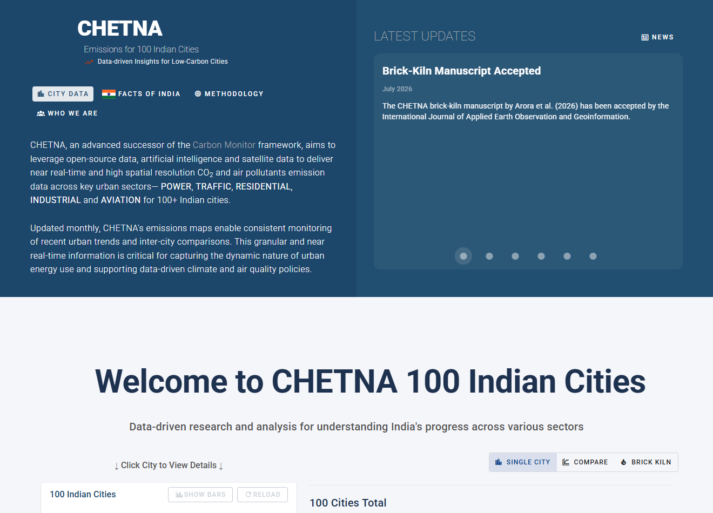

操作 2：开始录音，等待至少两个持久化音频片段

预期：界面处于录音状态；虚拟麦克风产生真实 MediaRecorder 数据

实际：界面处于录音状态；虚拟麦克风产生真实 MediaRecorder 数据（通过）

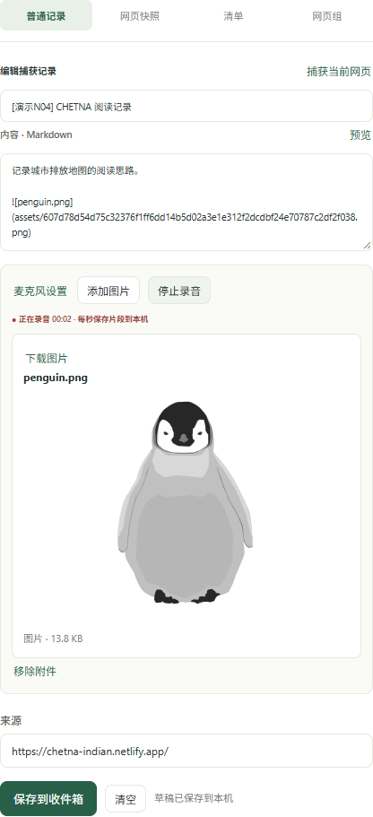

操作 3：预览网页来源、文字、图片和音频

预期：一条草稿同时具有四类内容

实际：一条草稿同时具有四类内容（通过）

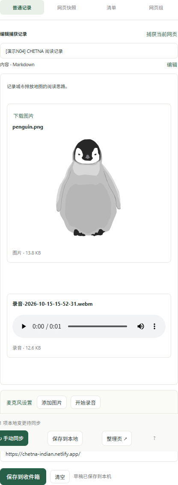

操作 4：保存到收件箱并核对持久化结果

预期：保存一条记录；ID、类型与来源/附件正确

实际：note；来源 1；附件 2（通过）

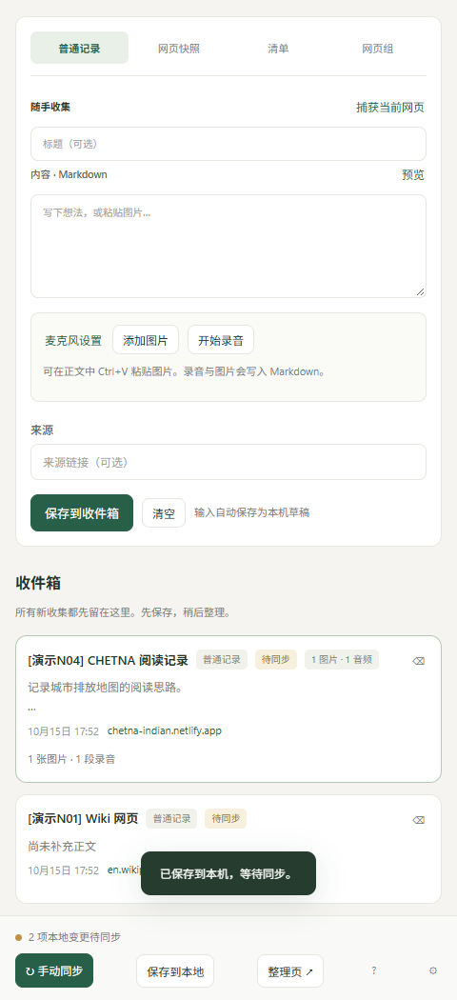

## 网页快照

### P01 · Wiki 页面快照

1. 打开 Wiki，等待标题和正文可见，选择网页快照并捕获。
2. 核对 PNG 预览、来源和标题，保存并重新打开。

验收条件：生成非空、可解码的 PNG；保存来源 URL。快照仅是当前可见区域。

本轮固定样例结果：**通过**。

操作 1：打开wiki页面并确认可见内容

预期：页面主体可见，未将错误页当作业务页面

实际：页面主体可见，未将错误页当作业务页面（通过）

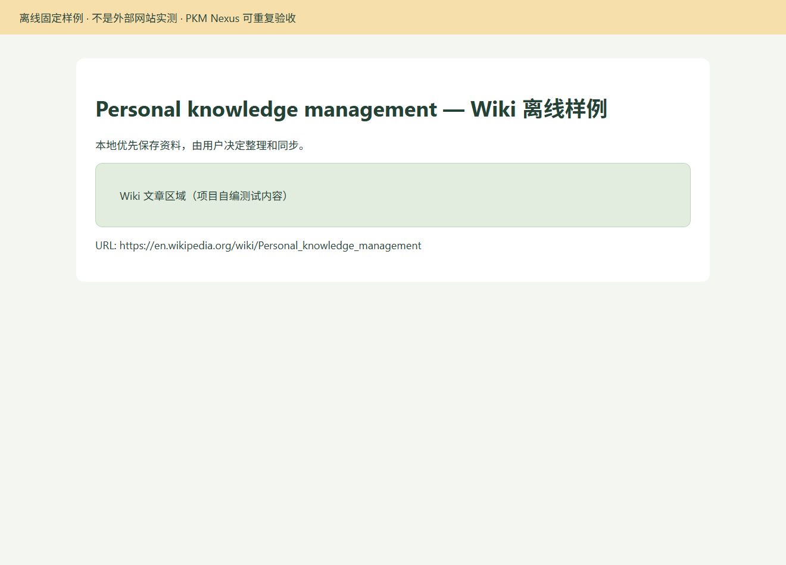

操作 2：捕获当前可见网页区域

预期：可解码的 PNG 预览与实际页面相符

实际：可解码的 PNG 预览与实际页面相符（通过）

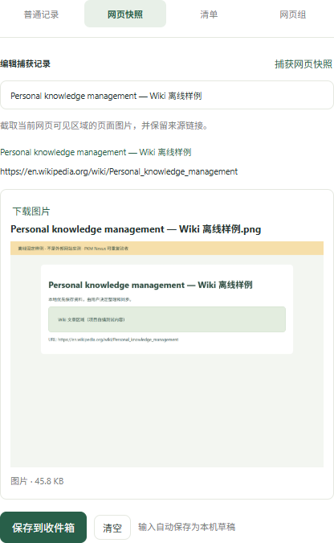

操作 3：保存到收件箱并核对持久化结果

预期：保存一条记录；ID、类型与来源/附件正确

实际：snapshot；来源 1；附件 1（通过）

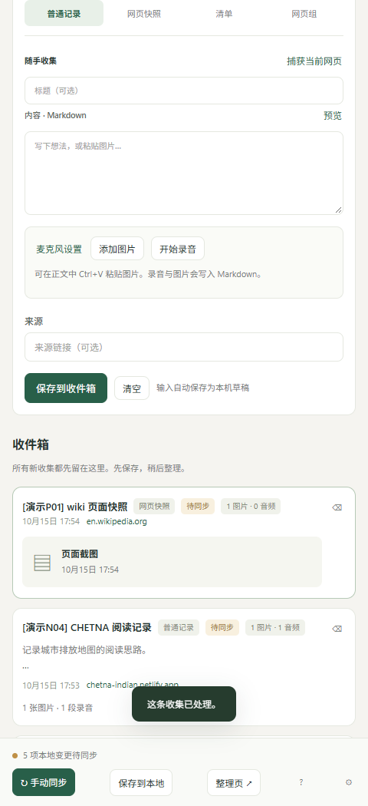

操作 4：重新打开快照

预期：已保存的图片仍可离线预览

实际：已保存的图片仍可离线预览（通过）

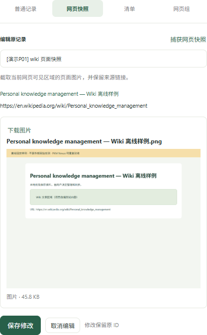

本轮真实网站结果：**通过**。

操作 1：打开wiki页面并确认可见内容

预期：页面主体可见，未将错误页当作业务页面

实际：页面主体可见，未将错误页当作业务页面（通过）

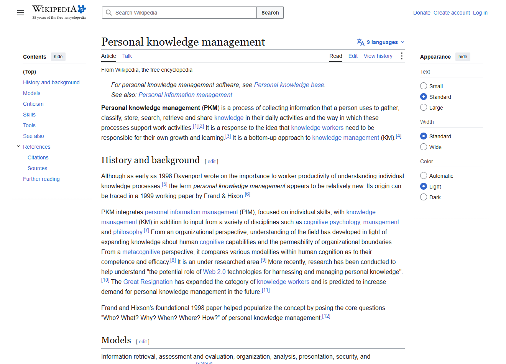

操作 2：捕获当前可见网页区域

预期：可解码的 PNG 预览与实际页面相符

实际：可解码的 PNG 预览与实际页面相符（通过）

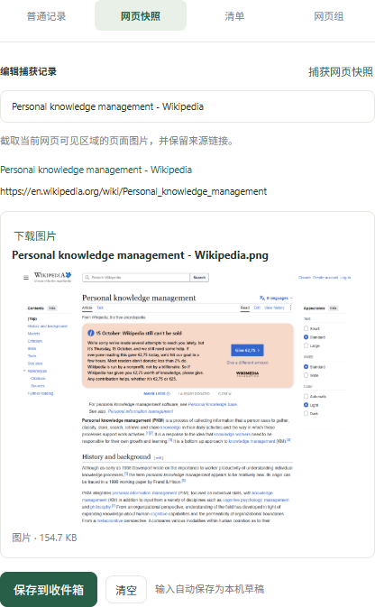

操作 3：保存到收件箱并核对持久化结果

预期：保存一条记录；ID、类型与来源/附件正确

实际：snapshot；来源 1；附件 1（通过）

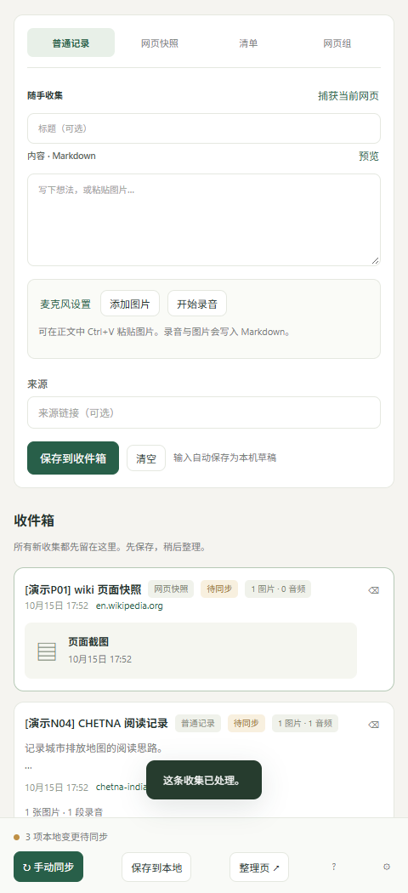

操作 4：重新打开快照

预期：已保存的图片仍可离线预览

实际：已保存的图片仍可离线预览（通过）

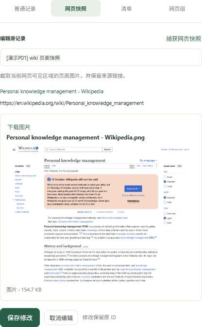

### P02 · Bilibili 视频页面快照

1. 打开 Bilibili 视频页，等待播放器或可识别的视频页内容可见。
2. 捕获、核对预览后保存；如有风控页，记录阻塞，不能以风控截图算通过。

验收条件：PNG 展示视频页当前可见内容；不录制、不下载视频本体。受限视频画面可能无法捕获，需记录实际结果。

本轮固定样例结果：**通过**。

操作 1：打开bilibili页面并确认可见内容

预期：页面主体可见，未将错误页当作业务页面

实际：页面主体可见，未将错误页当作业务页面（通过）

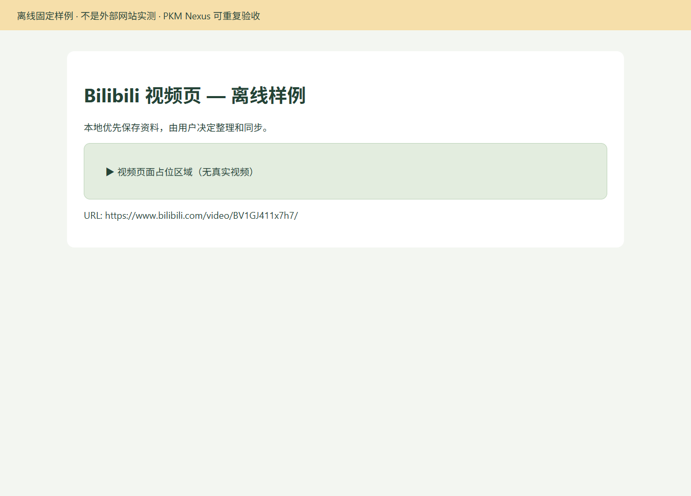

操作 2：捕获当前可见网页区域

预期：可解码的 PNG 预览与实际页面相符

实际：可解码的 PNG 预览与实际页面相符（通过）

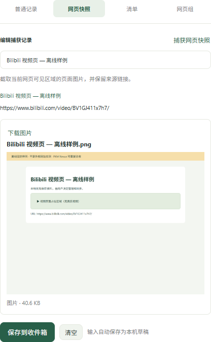

操作 3：保存到收件箱并核对持久化结果

预期：保存一条记录；ID、类型与来源/附件正确

实际：snapshot；来源 1；附件 1（通过）

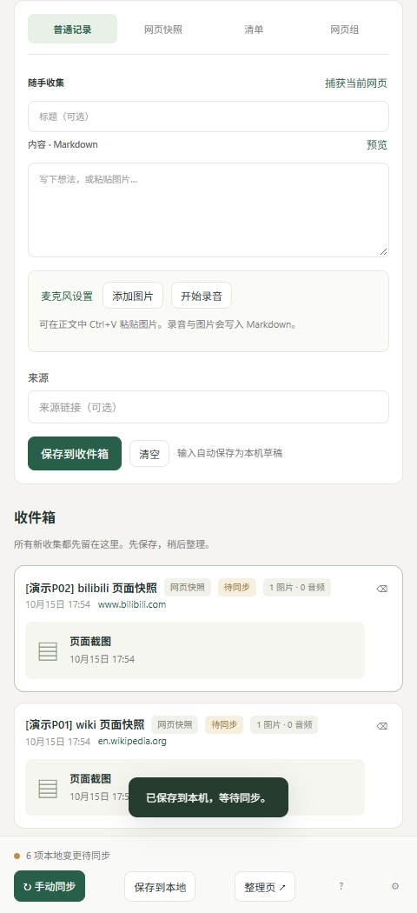

操作 4：重新打开快照

预期：已保存的图片仍可离线预览

实际：已保存的图片仍可离线预览（通过）

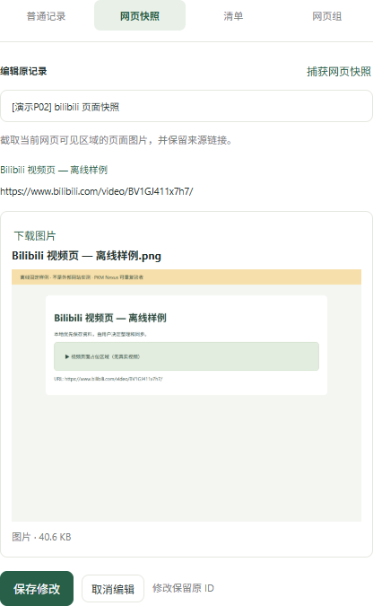

本轮真实网站结果：**阻塞**。真实页面未能就绪：locator.waitFor: Timeout 12000ms exceeded.

操作 1：记录本轮阻塞或失败状态

预期：PNG 展示视频页当前可见内容；不录制、不下载视频本体。受限视频画面可能无法捕获，需记录实际结果。

实际：真实页面未能就绪：locator.waitFor: Timeout 12000ms exceeded.（阻塞）

### P03 · CHETNA 页面快照

1. 打开 https://chetna-indian.netlify.app/，等待应用主体及图层加载。
2. 捕获并核对 PNG；如果只出现空壳或加载页，标记阻塞。

验收条件：截图与当前页面一致；保留 CHETNA 来源；不把加载页算作完整地图验证。

本轮固定样例结果：**通过**。

操作 1：打开chetna页面并确认可见内容

预期：页面主体可见，未将错误页当作业务页面

实际：页面主体可见，未将错误页当作业务页面（通过）

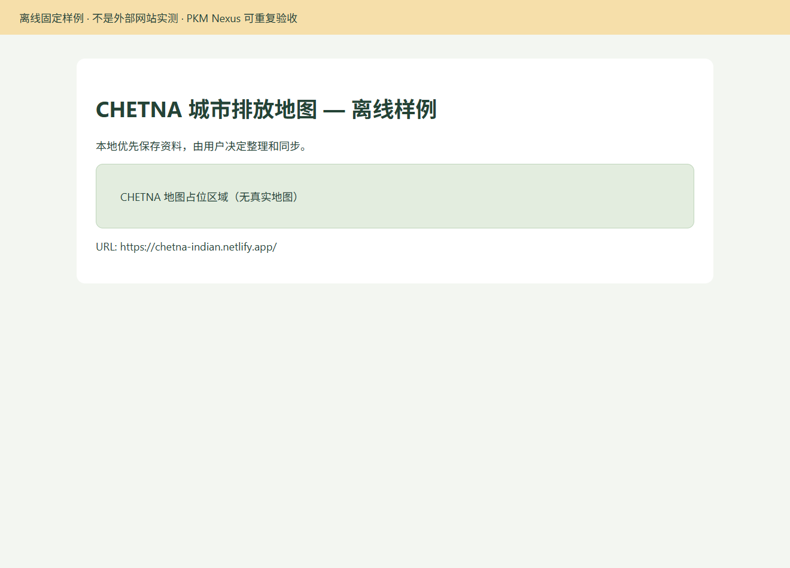

操作 2：捕获当前可见网页区域

预期：可解码的 PNG 预览与实际页面相符

实际：可解码的 PNG 预览与实际页面相符（通过）

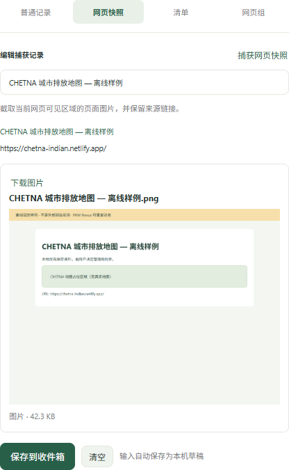

操作 3：保存到收件箱并核对持久化结果

预期：保存一条记录；ID、类型与来源/附件正确

实际：snapshot；来源 1；附件 1（通过）

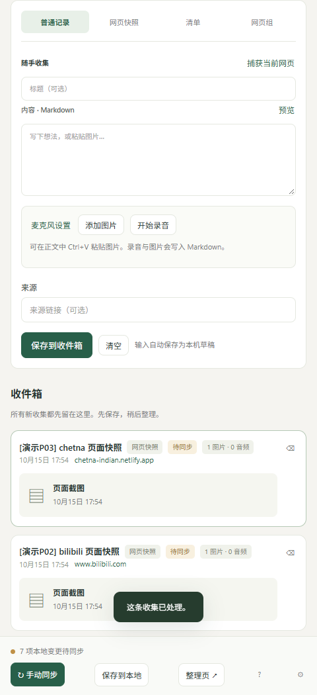

操作 4：重新打开快照

预期：已保存的图片仍可离线预览

实际：已保存的图片仍可离线预览（通过）

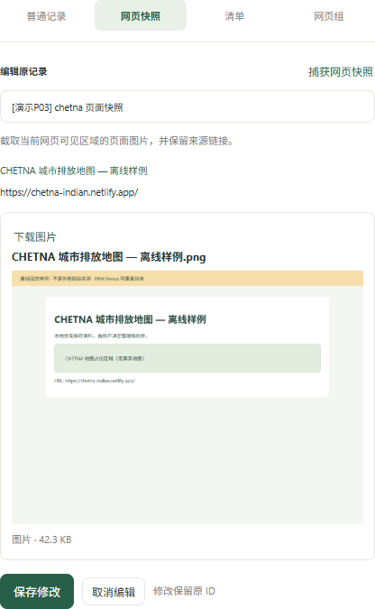

本轮真实网站结果：**通过**。

操作 1：打开chetna页面并确认可见内容

预期：页面主体可见，未将错误页当作业务页面

实际：页面主体可见，未将错误页当作业务页面（通过）

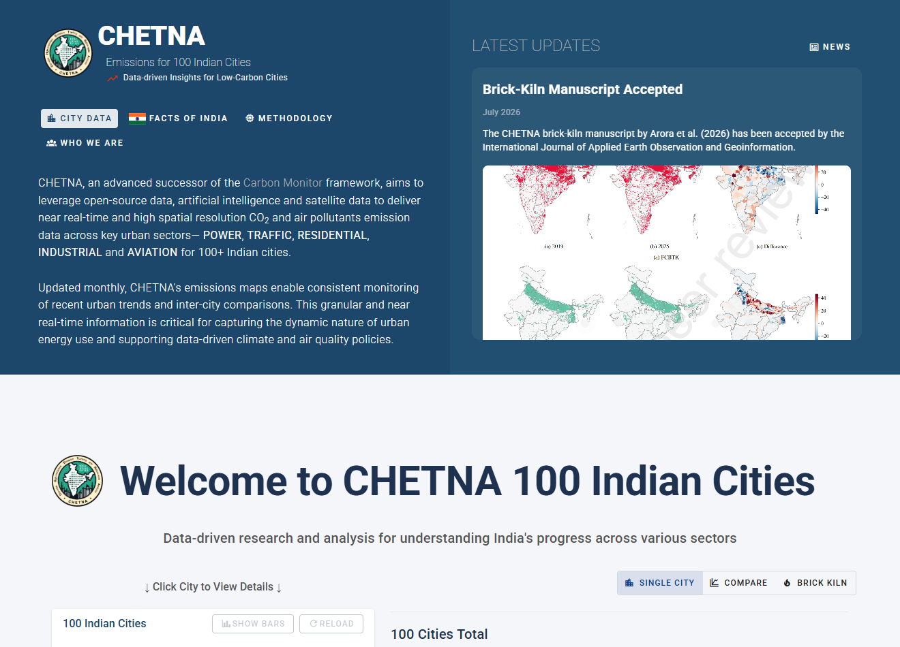

操作 2：捕获当前可见网页区域

预期：可解码的 PNG 预览与实际页面相符

实际：可解码的 PNG 预览与实际页面相符（通过）

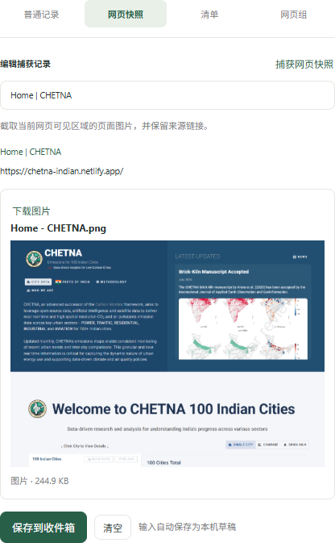

操作 3：保存到收件箱并核对持久化结果

预期：保存一条记录；ID、类型与来源/附件正确

实际：snapshot；来源 1；附件 1（通过）

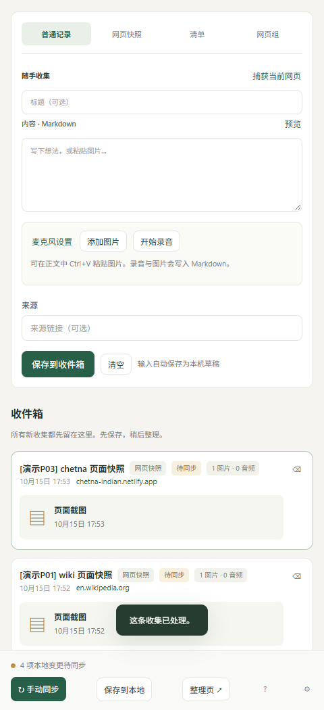

操作 4：重新打开快照

预期：已保存的图片仍可离线预览

实际：已保存的图片仍可离线预览（通过）

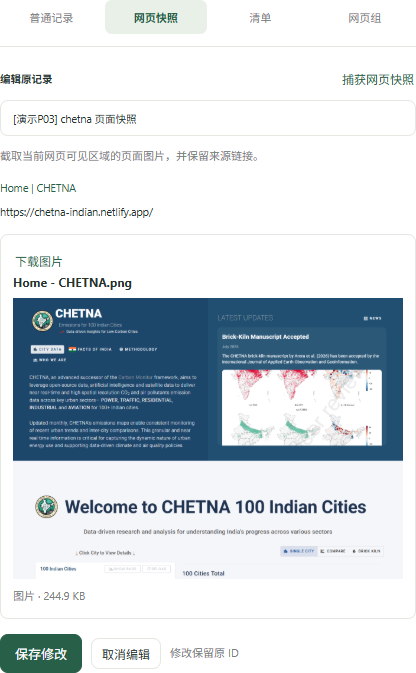

## Todo / Idea

### T01 · 工作主题 Todo

1. 进入唯一清单的 Todo 模式，添加：[工作] 整理会议笔记、[工作] 完成周报。
2. 勾选第一项，保存并重新打开核对。

验收条件：两项工作待办保留；第一项完成状态保留。

本轮固定样例结果：**通过**。

操作 1：添加Todo主题组

预期：主题项目与分割线按输入顺序显示

实际：主题项目与分割线按输入顺序显示（通过）

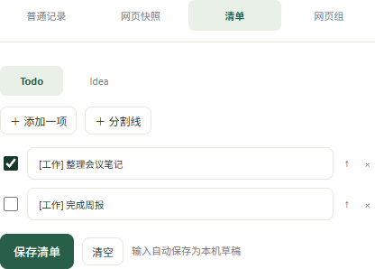

操作 2：保存后核对同一份全局清单

预期：已有主题、完成状态和同一 ID 都保留

实际：已有主题、完成状态和同一 ID 都保留（通过）

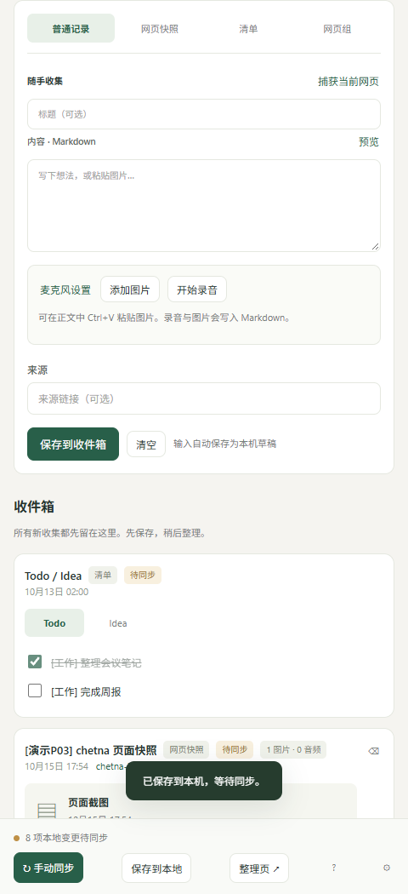

### T02 · 生活主题 Todo

1. 在 Todo 模式添加分割线，再添加：[生活] 购买咖啡、[生活] 预约运动。
2. 保存，重新打开并确认两组主题同时存在。

验收条件：四项待办与分割线共存，不创建第二份全局清单。

本轮固定样例结果：**通过**。

操作 1：添加Todo主题组

预期：主题项目与分割线按输入顺序显示

实际：主题项目与分割线按输入顺序显示（通过）

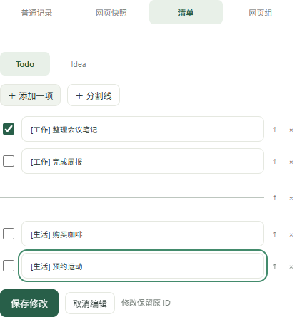

操作 2：保存后核对同一份全局清单

预期：已有主题、完成状态和同一 ID 都保留

实际：已有主题、完成状态和同一 ID 都保留（通过）

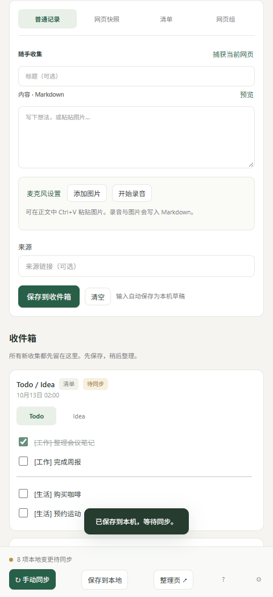

### T03 · 学习主题 Idea

1. 切换 Idea，添加：[学习] 用图谱整理阅读、[学习] 每周输出一篇总结。
2. 保存后重新打开 Idea。

验收条件：两条学习灵感为 bullet，没有完成复选框。

本轮固定样例结果：**失败**。locator.waitFor: Timeout 12000ms exceeded.

测试脚本说明：原脚本等待默认 Todo 卡片显示 Idea，断言不适用。已改为重新打开同一清单、切换正确模式后核对，但尚未重跑；T03 仍保留失败状态。

操作 1：添加Idea主题组

预期：主题项目与分割线按输入顺序显示

实际：主题项目与分割线按输入顺序显示（通过）

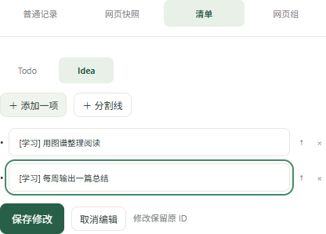

操作 2：记录本轮阻塞或失败状态

预期：两条学习灵感为 bullet，没有完成复选框。

实际：locator.waitFor: Timeout 12000ms exceeded.（失败）

此步未取得对应清单失败界面的截图；原日志误取了仍打开的来源页，不能把它作为清单失败证据。

### T04 · 产品主题 Idea

1. 在 Idea 中添加分割线，再添加：[产品] 快捷语音收集、[产品] 离线阅读队列。
2. 保存并在 Todo / Idea 间切换。

验收条件：两组 Idea 与两组 Todo 均保留，仍为同一份清单和同一 ID。

本轮结果：未执行，不能判为通过。

## 网页组

### G01 · Bilibili 视频组

1. 选择网页组，标题：[演示G01] Bilibili 视频；添加两个样例视频链接和可读标题。
2. 保存，标记第一个链接已读；重新打开核对。

验收条件：组内两个去重后的链接、标题及已读状态保留。仅验证归组不代表两个视频均可播放。

本轮结果：未执行，不能判为通过。

### G02 · Wiki 页面组

1. 标题：[演示G02] Wiki 知识管理；添加两个 Wiki 样例链接。
2. 保存后打开，核对链接数量、标题和来源。

验收条件：独立于 Bilibili 组；两条 Wiki 链接保留，不覆盖原组。

本轮结果：未执行，不能判为通过。

## 整理功能

### O01 · 批量标签和已整理

1. 在整理页搜索演示N，选择两条普通记录，批量添加：演示, 学习。
2. 重新选择这两条并标记已整理，在已整理视图核对。

验收条件：仅所选两条获得标签与已整理状态；其余记录不受影响。

本轮结果：未执行，不能判为通过。

### O02 · 项目归属与关系图

1. 新增项目：演示知识库，填写描述。
2. 手动加入两条记录，进入关系图预览并建立当前层级的关系。

验收条件：项目归属、关系和描述保留，禁止连接子项目内部或其他项目的记录。

本轮结果：未执行，不能判为通过。

### O03 · 搜索及筛选

1. 切回全部记录，搜索：周五；确认找到文字笔记。
2. 清空搜索，按普通记录和学习标签筛选。

验收条件：正文搜索和组合筛选正确，不因筛选隐藏而删除记录。

本轮结果：未执行，不能判为通过。

### O04 · 完整 ZIP 备份与恢复

1. 点击保存到本地，等待 ZIP 下载完成。
2. 在另一独立浏览器导入 ZIP，预览后确认；核对记录数与媒体校验值。

验收条件：备份含 JSON、Markdown、PNG 和音频；离线恢复保持 ID 和附件，不依赖云账号。

本轮结果：未执行，不能判为通过。

## 数据同步

### D01 · 浏览器交接到本地资料库

1. 正式环境先连接本地程序；自动化用测试传输桥调用同一交接实现。
2. 在本地管理界面确认浏览器记录与媒体。

验收条件：记录 ID、正文和媒体校验值一致。测试桥不等于真实 Native Messaging 安装验证。

本轮结果：未执行，不能判为通过。

### D02 · 两台设备双向同步

1. 办公室端上传，家庭端拉取；在家庭端修改文字并上传。
2. 办公室端再次同步，确认相同 ID 的新文字。

验收条件：两端收敛到相同记录；本次自动化使用 MockDrive，不连接真实 Google 账号。

本轮结果：未执行，不能判为通过。

### D03 · 过期副本冲突处理

1. 两端从同一版本离线分别修改；按办公室、家庭、办公室顺序同步。
2. 在冲突视图查看双方内容，明确采用其中一个版本后再次同步。

验收条件：双方内容在处理前均保留；人工选择后两端收敛，无静默覆盖。

本轮结果：未执行，不能判为通过。

### D04 · 附件按需加载

1. 家庭端只拉取记录，核对媒体未提前缓存。
2. 打开含图片记录并点击加载附件，校验实际文件。

验收条件：首次拉取只有描述；主动加载后文件 SHA-256 一致。

本轮结果：未执行，不能判为通过。

### D05 · 断网保留待同步修改

1. 修改一条记录，模拟上传请求失败并点击同步。
2. 核对错误与待上传状态，恢复连接后重试。

验收条件：失败不丢内容、不提前清除待上传标记；重试后两端一致。

本轮结果：未执行，不能判为通过。

### D06 · 真实 Google Drive 账号验收

1. 用户在本地程序配置桌面 OAuth、完成 Google 授权并绑定专用测试资料库。
2. 两台 Windows 执行 D02—D05，并在 Drive 网页核对可见资料库。

验收条件：真实账户端到端验收；没有 OAuth 配置时必须标记阻塞，模拟测试不能替代。

本轮结果：未执行，不能判为通过。

### D07 · 真实每小时计划任务

1. 完成 D06，用户开启每小时同步，关闭 Chrome。
2. 等待下一次整点周期或在任务计划程序主动运行，核对两端记录和任务日志；关闭自动同步。

验收条件：Chrome 关闭仍能同步；下次登录补同步；关闭后任务被移除。本轮不实际等待一小时。

本轮结果：未执行，不能判为通过。

## 内置帮助

### H01 · 在扩展内阅读说明书

1. 点击侧栏问号或整理页使用说明书，打开本地帮助页。
2. 查看目录、截图、测试流程与 Markdown 下载；断网后仍可阅读。

验收条件：文档与全部截图随扩展打包；不访问外部文档服务，无坏图。

本轮内置帮助结果：**通过**。

操作 1：从整理页打开内置使用说明书

预期：断网可读，目录和图片完整

实际：56 张本地截图可解码；目录检索、Markdown 来源和侧栏入口均通过（通过）

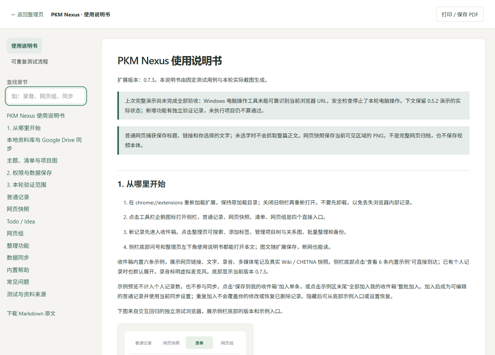

操作 2：查看可重复测试流程

预期：标准步骤、矩阵和命令随包提供

实际：测试矩阵可读，360px 无横向溢出；不执行 Markdown HTML 或脚本链接（通过）

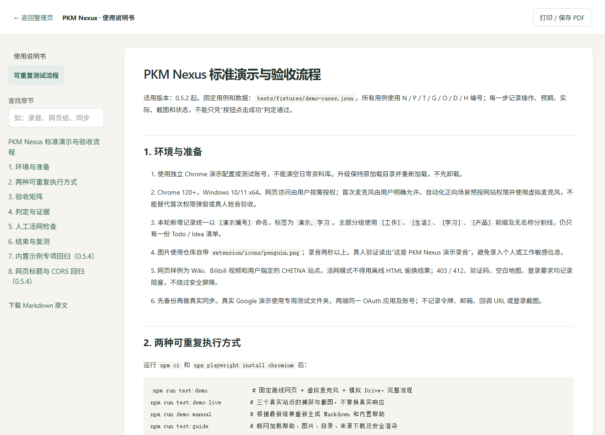

## 常见问题

• 捕获后正文为空：先在网页选中文字再捕获，或手动添加正文；只保存链接也是正常用法。
• 没看到内置示例：点击侧栏底部的查看 6 条内置示例；要作为真实个人记录显示，点击示例区末尾全部加入我的收件箱。刷新不会自动把预览写入个人资料库。
• 仍看到旧 CORS 错误：Chrome 扩展错误页保留历史日志。确认当前加载目录已更新，重新加载后关闭旧侧栏再打开，清除历史错误后重新添加链接，观察是否有新增错误。
• 看到重复提示：查看重复提示后选择追加、另存或取消，系统不会自动合并。
• Todo / Idea 如何分主题：当前只有一份清单，使用主题前缀和分割线；Todo 的完成状态与 Idea 的 bullet 独立保留。
• Bilibili 风控或地图空白：等待真实页面就绪；风控、登录或图层错误不算完成了网站快照验收，不绕过验证。
• 录音没有人的声音：本轮自动化使用虚拟麦克风，请用真人声音另做一次 N03 / N04。
• Google Drive 无法同步：先在本地程序设置桌面 OAuth，完成用户授权，再绑定专用资料库。两台电脑使用同一 OAuth 应用、账号和资料库 ID；无需 Drive 桌面客户端。
• 每小时同步：只在用户明确开启后注册 Windows 任务；电脑休眠或关机不执行，登录后补运行。真实授权与任务验收见 D06 / D07。

## 测试与资料来源

重复测试命令、环境准备和判定规则可在左侧可重复测试流程中阅读。仓库固定用例：tests/fixtures/demo-cases.json；结果：docs/demo-results；每次运行原始证据：test-results/demo-runs。

[Wiki 样例](https://en.wikipedia.org/wiki/Personal_knowledge_management) · [Bilibili 样例](https://www.bilibili.com/video/BV1GJ411x7h7/) · [CHETNA](https://chetna-indian.netlify.app/)

[Chrome 可选权限](https://developer.chrome.com/docs/extensions/reference/api/permissions) · [Google 桌面 OAuth](https://developers.google.com/identity/protocols/oauth2/native-app)
